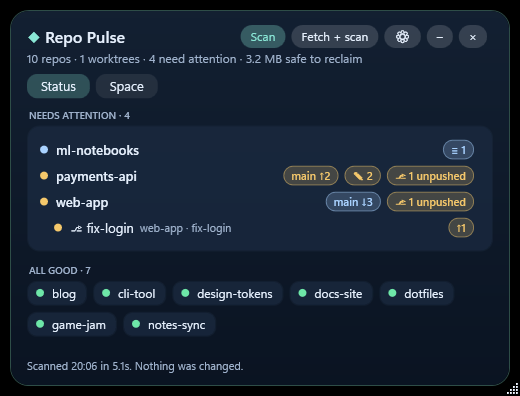

# Repo Pulse

**Every local repo, at a glance, and the disk space you can safely take back.**
A small Windows glass widget (plus a cross-platform command line) for developers with too many
repositories, clones and AI-agent worktrees. Sibling of [Prism](https://github.com/kumarnabh/prism-widget).

[](https://github.com/kumarnabh/repo-pulse/actions/workflows/ci.yml)
[](https://github.com/kumarnabh/repo-pulse/releases/latest)


<p align="center"></p>

[Download](https://github.com/kumarnabh/repo-pulse/releases/latest) · [Specification](SPEC.md) · [Testing](TESTING.md) · [Troubleshooting](TROUBLESHOOTING.md) · [Changelog](CHANGELOG.md) · [Contributing](CONTRIBUTING.md)

## What it does

- **Status**: does local `main` agree with `origin/main`? Ahead, behind, diverged, dirty files with +/− counts and a click-to-view diff, stashes, unpushed branches.
- **Backup**: one click copies dirty files, bundles unpushed commits and saves every stash as a patch. The repository itself is not touched.
- **Sync**: fast-forward only. Push without force. Never merges, rebases or force-pushes.
- **Space**: merged or fully pushed branches, stale worktrees (including AI-agent worktrees), `node_modules`, `.venv`, build caches, git garbage and global package caches, each marked **Safe** or **Review** with its size.
- **Finds everything**: every fixed drive, plus folders known to Claude Code, Codex, VS Code, Cursor, Windsurf and JetBrains IDEs, plus every linked worktree (⎇) wherever it lives. Skip any folder you like.
- **Compact**: problems as one-line rows, healthy repos as tiles; the window fits its content with no scrollbar.

## Install (Windows)

1. Install **[Python 3.10+](https://www.python.org/downloads/)** with the `py` launcher (the default installer option). Git must be on `PATH`.
2. Download **`RepoPulse-<version>-win-x64.zip`** from the [latest release](https://github.com/kumarnabh/repo-pulse/releases/latest) and unzip it anywhere you can write to (for example `%USERPROFILE%\Apps\RepoPulse`).
3. Run **`Launch Repo Pulse.cmd`**.

Already have the .NET 8 Desktop Runtime? The `…-needs-dotnet8.zip` download is about 200 KB instead of about 65 MB.
Releases are not code-signed yet, so Windows SmartScreen may ask you to confirm the first launch
(**More info → Run anyway**). Each release lists SHA-256 checksums in `SHA256SUMS.txt`.

The first scan is read-only. Use **Fetch + scan** (Shift+F5) for accurate ahead/behind numbers. In **⚙**,
limit scanning to your code folders (for example `D:\Code;C:\Users\you\source\repos`) for faster scans, or list
folders to skip. Hover the summary line to see which folders were searched and how each repository was found.

## What "Safe" means

| Item | Safe only when |
|---|---|
| Branch | Not the default branch, not checked out anywhere, every commit is on a remote, and the last fetch is under 24 h old |
| Worktree | Folder already gone (stale metadata), or clean, unlocked, fully pushed **and holding no ignored files except rebuildable folders** (a `.env` keeps it in Review) |
| Folder | Known rebuildable folder, git-ignored, contains no tracked files, rebuild manifest present |
| git gc | Over 50 MB of loose or garbage objects (normal prune window) |

Everything else is **Review** (needs your explicit selection) or **kept** and never offered.
Every item is re-checked immediately before removal. Branches are saved as git bundles first;
folders go to the Recycle Bin. Restore a branch with:

```
git fetch "<backup>\branch-NAME.bundle" NAME:NAME
```

## Command line

The core is one standard-library Python file and works without the widget, on Windows, Linux and macOS:

```
python repopulse.py scan --text                     # readable report: every fixed drive + tool history + worktrees
python repopulse.py scan --fetch --roots "D:\Code" --exclude "D:\Code\archive"
python repopulse.py scan --roots ~/code --no-hints  # JSON, only this folder
python repopulse.py backup --repo "D:\Code\app"
python repopulse.py sync   --repo "D:\Code\app" [--push]
python repopulse.py clean  --repo "D:\Code\app" --ids ID1,ID2   # ids are shown by scan --text
```

Every command except `--text` prints one JSON object (see [SPEC.md](SPEC.md) for the fields).
On Windows, `py -3` works in place of `python`. Outside Windows, "Recycle Bin" means
`~/RepoPulse Backups/Trash`.

## Privacy

Local only. No telemetry, accounts or network calls, except `git fetch` and `git push`
when you ask for them. Settings live in `data\settings.json` next to the program.
Tool-history files (`~/.claude.json`, Codex and editor state) are only read, never changed.

## Build from source

Needs Python 3.10+ and the [.NET 8 SDK](https://dotnet.microsoft.com/download/dotnet/8.0).

```
git clone https://github.com/kumarnabh/repo-pulse.git
cd repo-pulse
Build.cmd
```

`Build.cmd` builds `RepoPulse.exe` into the folder; then run `Launch Repo Pulse.cmd`.

| Path | Purpose |
|---|---|
| `repopulse.py` | Core: discovery, scan, classification, backup, sync, cleanup. Standard library only. |
| `source/` | .NET 8 WPF widget (code-only, no XAML) that calls the core and renders its JSON. |
| `tests/` | Fixture tests with real git repositories. |
| `.github/workflows/` | CI on Windows, Linux and macOS; tagged releases build the downloads. |

## Tests

```
python -m unittest discover -s tests -v
```

31 fixture tests run real git operations against a local bare remote, covering unpushed
commits, stale fetches, squash-merged branches, dirty, locked or secret-holding worktrees, tracked
files inside junk folders, and changes made between scan and cleanup. See [TESTING.md](TESTING.md)
for the manual Windows checklist.

## Not in scope

Merging, rebasing, conflict resolution, force-push, scheduled or automatic cleanup, and
anything needing administrator rights. Repo Pulse shows the problem; you resolve it.

[MIT License](LICENSE).
